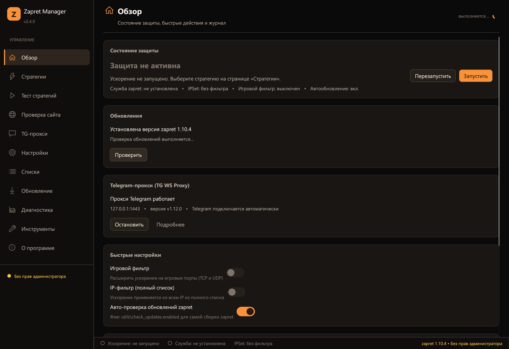

# Zapret Manager


Графическая оболочка для **[zapret-discord-youtube](https://github.com/Flowseal/zapret-discord-youtube)** —
сборки [zapret](https://github.com/bol-van/zapret) (автор **bol-van**) для ускорения соединения
Discord и YouTube.

Приложение полностью написано на **Rust**: один нативный `.exe` без .NET, WinForms и внешних
зависимостей (GUI на `egui`/`eframe`, системный WinHTTP, Win32 API). C#-версия больше не
поддерживается; актуальная ветка — **`main`**.



## Что умеет

| Раздел | Возможности |
| --- | --- |
| **Обзор** | Состояние защиты, стратегия/PID/uptime, запуск–остановка–перезапуск, быстрые переключатели игрового фильтра, IP-списка и авто-проверки, **память winws/TG WS Proxy**, живой журнал |
| **Стратегии** | Все `general*.bat` с описаниями и метками BASE/ALT/EXP, **поиск и избранное ★**, предпросмотр и копирование полной команды `winws.exe`, запуск, установка службой Windows |
| **Тест стратегий** | Прогон всех стратегий по целям из `utils\targets.txt`, таблица «да/нет/1 из N», **оценка по сервисам (60%)**, ★ у лучшей, **долгий автоподбор desync-параметров** (включая `hostfakesplit`, `fake-tls-mod`, `badseq`), сохранение `general (AUTO).bat`, **применение с проверкой и откатом**, отчёт в `data\test-results.tsv`, разбор официального отчёта `utils\test zapret.ps1` |
| **Проверка сайта** | Пошаговая диагностика DNS → TCP → TLS → HTTP, вердикт («похоже на ТСПУ», «DNS», «TLS», «HTTP»), подбор связанных доменов, добавление в свой список или `hosts`, **сторож с журналом перехваченных доменов**, наблюдение за приложением по журналу DNS |
| **TG-прокси** | Поиск установленного TG WS Proxy, состояние и порт, запуск/остановка/перезапуск, ссылка `tg://proxy`, установка обновлений с GitHub, **тихий режим из исходников без иконки в трее**, автозапуск |
| **Настройки** | **Папка zapret (выбор/установка с нуля)**, игровой фильтр и порты, режимы IPSet, обновление IP-листа, замена активных фейк-пакетов, тема и масштаб, TCP timestamps, очистка кэша Discord, автозапуск через планировщик, **автолечение ускорения** |
| **Списки** | Редактор 8 файлов списков, подсветка дублей и `*.`, массовая вставка и «причёсывание», **пометка своих изменений** в официальных списках (`baseline`/`changes`/`news`) с переносом при обновлении zapret |
| **Обновление** | Проверка релизов Flowseal, установка любой версии (в том числе откат), резервная копия и откат, сохранение пользовательских списков, обновление самого менеджера, **окно «Доступны обновления» при старте с версиями компонентов** |
| **Диагностика** | ~25 проверок: BFE, службы-конфликты (Killer, Intel, Check Point, SmartByte, VPN, сторонние ускорители), прокси, TCP timestamps, DoH, hosts, целостность списков, **аудит и докачивание fake-файлов (blobs)**, зависший WinDivert, TG WS Proxy — с кнопками исправления |
| **Инструменты** | Служба Windows, файл hosts (официальный список), официальный тест стратегий, кэш Discord, папки, **резервная копия настроек и списков `.zmb`** |
| **О программе** | Крупный логотип, версия, компоненты, лицензия, ссылки и поддержка проекта |

Скриншоты: [Стратегии](docs/rust/screenshots/strategies.png) ·
[Тест](docs/rust/screenshots/test.png) · [Списки](docs/rust/screenshots/lists.png) ·
[Настройки](docs/rust/screenshots/settings.png) · [TG-прокси](docs/rust/screenshots/tgproxy.png) ·
[О программе](docs/rust/screenshots/about.png)

## Сборка

Нужен **Rust 1.80+** для Windows (x86_64). Проще всего установить через [rustup](https://rustup.rs).

```powershell
# из корня репозитория
cargo build --release
# готовый файл: target\release\ZapretManager.exe
```

Или скриптом (сам выставит ASCII-путь сборки и соберёт `dist\` с контрольной суммой):

```powershell
.\build.ps1
```

**Про GNU-тулчейн.** Если Rust установлен с `x86_64-pc-windows-gnu`, линковщик MinGW не умеет
работать с путями, где есть кириллица или пробелы. Поэтому `build.ps1` и CI собирают с
`CARGO_TARGET_DIR` во временной ASCII-папке; при ручной сборке из такой папки задайте её сами:

```powershell
$env:CARGO_TARGET_DIR = "$env:TEMP\zapret-build"
cargo build --release
```

С MSVC-тулчейном (`x86_64-pc-windows-msvc`) это не требуется.

## Запуск

```
ZapretManager.exe                 — обычный запуск (UAC запросится, если нужно)
ZapretManager.exe --tray          — свернуться в трей
ZapretManager.exe --autostart     — тихий старт (задача планировщика)
ZapretManager.exe --root=<папка>  — указать папку zapret вручную
ZapretManager.exe --diag          — прогнать диагностику в журнал и выйти
ZapretManager.exe --selftest      — внутренняя самопроверка (11 проверок) и выход с кодом 0/1
ZapretManager.exe --check-site=<домен> — проверить сайт из командной строки
ZapretManager.exe --app-watch=<PID>    — наблюдение за приложением 20 с и добавление найденного
ZapretManager.exe --guard-once    — один проход фонового сторожа
ZapretManager.exe --cleanup       — убрать старые резервные копии и временные файлы
ZapretManager.exe --tg-prepare    — скачать исходники TG WS Proxy и портативный Python
ZapretManager.exe --tg-start      — запустить TG WS Proxy (с учётом выбранного режима)
ZapretManager.exe --tg-stop       — остановить TG WS Proxy
ZapretManager.exe --check-self    — проверить обновление менеджера
ZapretManager.exe --self-update   — обновиться без интерфейса
ZapretManager.exe --apply-update  — служебный режим замены exe (вызывается автоматически)
```

Журнал и настройки — в `data\` рядом с exe (если папка недоступна для записи —
`%APPDATA%\ZapretManager`). Формат `manager.ini` совместим с C#-версией.

## Как это устроено

```
src/
  main.rs            — точка входа, CLI-режимы, UAC, один экземпляр
  lib.rs             — библиотека (движок + интерфейс)
  build.rs           — встраивание иконки и версии в exe (windres/rc.exe)
  util.rs            — версии, натуральная сортировка, SHA-256, время, валидация
  engine/            — вся логика без UI
    install.rs       — поиск установки zapret, разбор стратегий и версии
    bat.rs           — превращение .bat-стратегии в аргументы winws.exe
    ops.rs           — запуск/остановка winws, служба, IPSet, фейки, hosts, кэш Discord
    service.rs       — Service Control Manager (без sc.exe)
    process.rs, sys.rs — Win32: процессы, реестр, UAC, окна, значок в трее
    http.rs          — HTTP-клиент на WinHTTP (системный TLS, редиректы, прогресс)
    netcheck.rs      — DNS/TCP/TLS/HTTP/ICMP-проверки
    doctor.rs        — доктор сайтов, связанные адреса, запись в списки/hosts
    guard.rs         — фоновый сторож по журналу DNS (wevtutil)
    appprobe.rs      — проверка приложения
    lists.rs         — пометка изменений официальных списков, чистка, вставка
    tester.rs        — тест стратегий и разбор официальных отчётов
    diagnostics.rs   — проверки и исправления
    update.rs        — GitHub Releases, установка zapret и самообновление
    tgproxy.rs       — TG WS Proxy (exe с треем и тихий режим)
    tgsource.rs      — тихий режим: исходники Flowseal + портативный Python
    autostart.rs     — задача планировщика (XML, без проблем с кавычками)
  ui/                — egui/eframe
    app.rs           — окно, сайдбар, статусбар, фоновые задачи, уведомления
    theme.rs         — тёмная/светлая палитра, системные шрифты Segoe UI/Consolas
    widgets.rs       — карточки, кнопки, переключатели, прогресс
    tray.rs          — Shell_NotifyIcon и собственное меню в отдельном потоке
    pages/           — 11 страниц + мастер первой настройки
```

Внешние крейты: `eframe`/`egui` (GUI), `windows-sys` (Win32), `native-tls` (TLS-проверка с SNI),
`zip` (распаковка обновлений), `serde_json` (GitHub API), `png` (иконки), `rfd` (диалоги файлов).

## Отличия от C#-версии

- Нет .NET и WinForms: один exe, интерфейс рисуется `egui`, шрифты берутся из Windows.
- Служба создаётся через SCM API, а не `sc.exe`; автозапуск — через XML-задачу планировщика.
- HTTP — WinHTTP с системным TLS 1.2/1.3 вместо `HttpWebRequest`.
- Журнал DNS читается через `wevtutil` (XML), а не `EventLogReader`.
- Список процессов и командные строки — Toolhelp + `NtQueryInformationProcess` вместо WMI.
- **Тихий режим TG WS Proxy** перенесён: страница «TG-прокси» скачивает официальные
  исходники Flowseal и портативный Python, запускает прокси через `pythonw.exe` — без окна
  и без иконки в трее. Системный Python не нужен.
- Самообновление менеджера рассчитано на публичные GitHub Releases; при отсутствии релизов
  кнопка показывает ошибку и не мешает обновлять zapret.
- Скриншот-режим (`--shot=<файл> --shot-page=<страница>`) встроен для документации и тестов.
- Иконки разделов — из системного шрифта Segoe MDL2 Assets (Windows 10/11), с запасными символами.
- Окно запоминает размер и состояние «развёрнуто»; заголовок окрашивается под тему.
- Для приватного репозитория самообновление можно включить переменной `ZAPRET_GITHUB_TOKEN`
  (токен с доступом к релизам): тогда проверка и скачивание идут через GitHub API.

## Проверки

```powershell
cargo test      # 37 тестов: .bat-парсер, списки, версии, SHA-256, время, сеть
cargo clippy    # по желанию
```

## Антивирус и ложные срабатывания

Defender иногда помечает `ZapretManager.exe` как `Trojan:Win32/Bearfoos.A!ml` —
это ложное срабатывание ML-эвристики для неподписанной утилиты, которая
управляет сетью, службами и WinDivert. Проверьте SHA-256 релиза, восстановите
файл из карантина и отправьте ложное срабатывание в Microsoft.

Подробно: [SECURITY.md](SECURITY.md).

## Лицензия

MIT — см. [LICENSE](LICENSE). Copyright (c) 2026 RoBiN19666.

Проект не содержит код zapret, zapret-discord-youtube, TG WS Proxy и WinDivert: они скачиваются
с официальных источников и распространяются по своим лицензиям.
