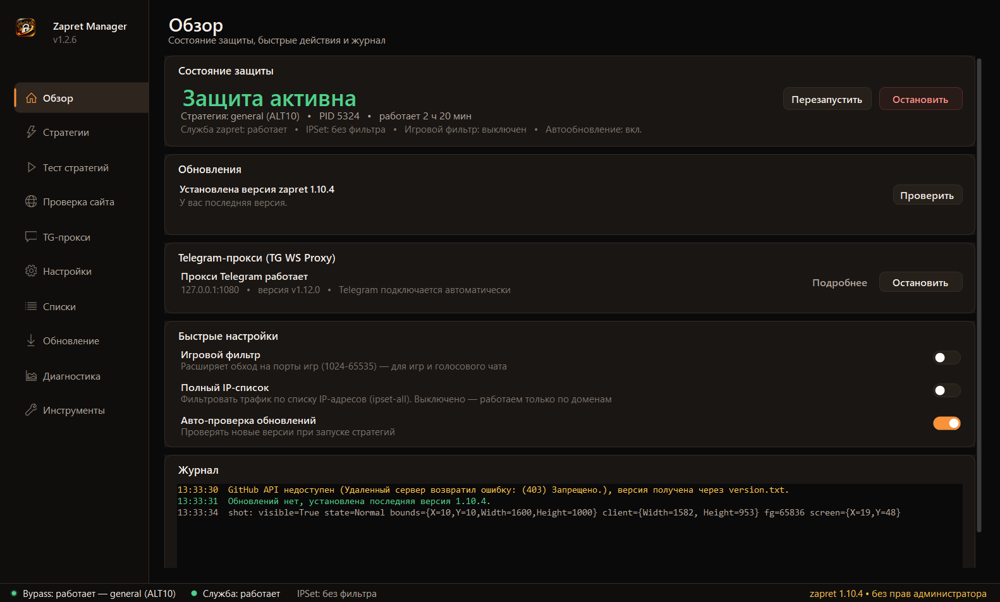
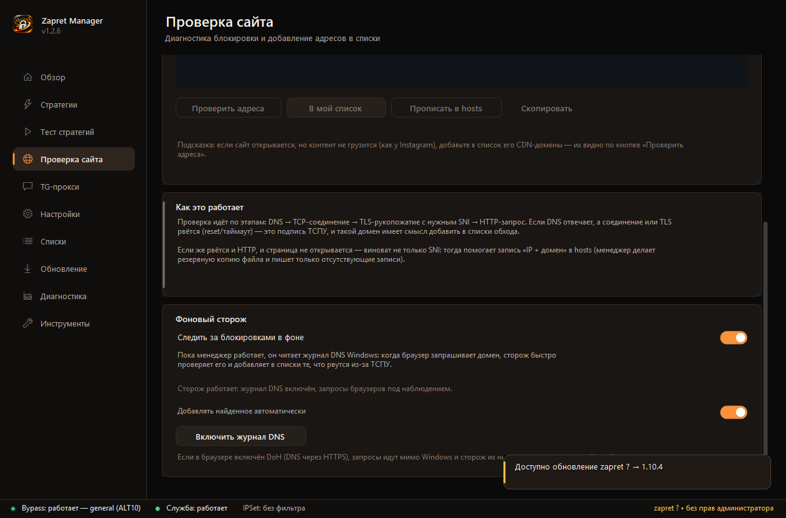
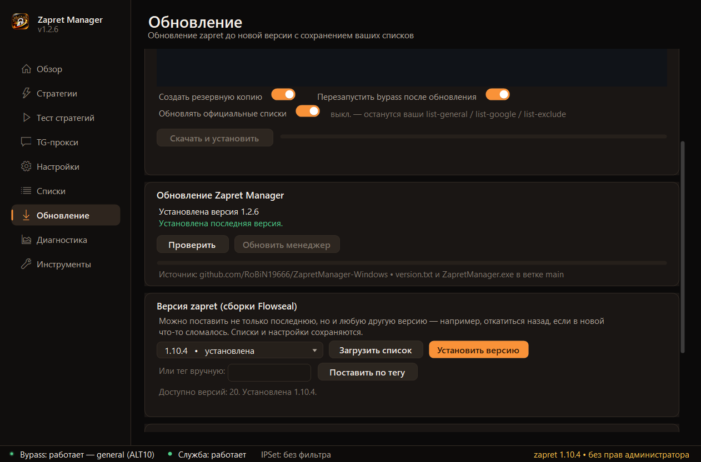

# Zapret Manager

Графическая оболочка (один `.exe`, без установки и зависимостей) для
[zapret-discord-youtube](https://github.com/Flowseal/zapret-discord-youtube) —
инструмента обхода DPI-блокировок Discord и YouTube, построенного на
[zapret](https://github.com/bol-van/zapret) (автор — **bol-van**).

Приложение не заменяет zapret: оно кладётся рядом с `service.bat`, находит установку,
читает ваши `.bat`-стратегии и запускает `winws.exe` с теми же аргументами,
что и оригинальные батники, но из одного удобного окна.



Скриншоты остальных разделов — в папке [`docs`](docs):
[Стратегии](docs/strategies.png) · [Тест стратегий](docs/test.png) · [TG-прокси](docs/tgproxy.png) · [Настройки](docs/settings.png) ·
[Списки](docs/lists.png) · [Обновление](docs/update.png) · [Диагностика](docs/diagnostics.png) ·
[Инструменты](docs/tools.png) · [Мастер первой настройки](docs/wizard.png) · [Диалог подтверждения](docs/dialog.png)

## Что умеет

| Раздел | Возможности |
| --- | --- |
| **Обзор** | Состояние защиты, выбранная стратегия, PID и время работы, запуск/остановка/перезапуск, быстрые переключатели игрового фильтра, IP-списка и авто-проверки обновлений, живой журнал |
| **Стратегии** | Список всех `general*.bat` с описаниями, запуск вручную, установка выбранной стратегии как службы Windows, предпросмотр и копирование итоговой команды `winws.exe` |
| **TG-прокси** | Управление [TG WS Proxy](https://github.com/Flowseal/tg-ws-proxy): статус и порт, запуск/остановка независимо от zapret, ссылка `tg://proxy` и открытие Telegram одним нажатием, проверка и установка обновлений с GitHub, выбор папки |
| **Проверка сайта** | Диагностика блокировки по этапам (DNS → TCP → TLS → HTTP), подбор связанных доменов и добавление их в списки или в `hosts` |
| **Тест стратегий** | Прогон всех стратегий по очереди с таблицей результатов: каждая цель из `utils\targets.txt` (Discord, YouTube, Google, Cloudflare, ping) отмечается ✓/✗ с задержкой. Лучшая стратегия помечается ★, из таблицы можно сразу запустить её или поставить службой. Есть отчёт в TSV, таймаут, «глубокая проверка» 16 КБ и остановка прогона |
| **Настройки** | Игровой фильтр (выкл / TCP и UDP / только TCP / только UDP, свои диапазоны портов), режим IPSet, обновление IP-листа, замена активных фейк-пакетов, TCP timestamps, очистка кэша Discord |
| **Списки** | Редактор пользовательских списков + **пометка ваших изменений в официальных списках** (см. ниже) |
| **Обновление** | Проверка новых версий zapret на GitHub, скачивание официального архива, автоматическая установка с сохранением ваших списков и настроек, резервная копия, перезапуск bypass |
| **Диагностика** | ~20 проверок: BFE, прокси, TCP timestamps, Adguard, Killer, Intel Connectivity, Check Point, SmartByte, VPN, DoH, hosts, целостность списков, зависший драйвер WinDivert, конфликтующие bypass-службы. Для части проблем есть кнопка «исправить» |
| **Инструменты** | Управление службой, применение официального `hosts`, официальный скрипт теста стратегий, **мастер установки**, папки и ссылки |

## Проверка сайта (доктор)

Страница **«Проверка сайта»** отвечает на вопрос «этот сайт не открывается из-за блокировки или он просто лежит?»:

1. **DNS** — резолвится ли домен и в какие адреса.
2. **TCP :443** — устанавливается ли соединение (и сколько миллисекунд).
3. **TLS с нужным SNI** — проходит ли рукопожатие именно для этого домена.
4. **HTTP** — что отвечает сервер (код, заголовок страницы).

Вердикт:

- *«Сайт открывается напрямую»* — блокировки на этом домене нет;
- *«Похоже на блокировку ТСПУ»* — DNS отвечает, а TCP/TLS рвётся (reset/таймаут) — это подпись DPI;
- *«Домен не резолвится»* — опечатка или DNS-блокировка (тогда поможет `hosts`);
- *«HTTP-ошибка»* — сервер отвечает, провайдер тут ни при чём.

Дальше менеджер подбирает **связанные адреса**: сам домен, его поддомены, а если страница хоть как-то отдаётся — ещё и хосты, упомянутые в HTML (CDN, статика, API). Каждый адрес проверяется отдельно, проблемные идут первыми. Список можно править руками, а затем:

- **«Проверить адреса»** — прогнать TCP/TLS по каждой строке, проблемные помечаются комментарием `#`;
- **«В мой список»** — дописать домены в `lists\list-general-user.txt` (ваш список, он не перезаписывается при обновлении zapret);
- **«Прописать в hosts»** — определить IP и дописать записи «IP домен» в системный `hosts` (с резервной копией файла). Это то самое «айпи-сопоставление», которое нужно некоторым сервисам вроде Instagram;
- **«Скопировать»** — забрать список в буфер.

После добавления перезапустите bypass, чтобы winws перечитал списки.


Честное ограничение: доктор видит только то, что можно проверить снаружи. Если сервис тянет десятки адресов (Instagram, Facebook), часть CDN-доменов может не попасть в список автоматически — тогда добавьте их руками через «Вставить список» и проверьте кнопкой «Проверить адреса».

## Фоновый сторож сайтов

Можно не проверять руками: включите «Проверка сайта» → «Фоновый сторож» → **«Следить за блокировками в фоне»**.

Как работает:

1. Сторож читает журнал Windows `Microsoft-Windows-DNS-Client/Operational` — из него видно, какие имена запрашивали браузеры (chrome, msedge, firefox, opera, brave, vivaldi, yandex).
2. Каждое новое имя быстро проверяется: TCP :443 + TLS-рукопожатие с этим SNI.
3. Если соединение рвётся (reset/таймаут) — это подпись ТСПУ. Домен сразу дописывается в
   `lists\list-general-user.txt` (ваш список, обновление zapret его не трогает), появляется
   уведомление в окне и в трее.
4. Уже покрытые списками домены пропускаются, каждый домен проверяется не чаще раза в час,
   за один цикл — максимум 5 проверок, чтобы не грузить систему.

Тонкости:

- журнал DNS по умолчанию выключен в Windows; менеджер включает его сам при первом включении
  сторожа (нужны права администратора) — кнопка «Включить журнал DNS» делает это вручную;
- если в браузере включён **DoH** (DNS через HTTPS), запросы идут мимо Windows, и сторож их
  не увидит — тогда проверяйте сайт вручную на этой же странице;
- сторож добавляет только домен, который не открылся. CDN-домены сервиса (как у Instagram)
  подбираются кнопкой «Проверить адреса» на странице «Проверка сайта».



## Массовая вставка доменов

В «Списках» есть две кнопки под редактором:

- **«Вставить список»** — вставьте домены в любом виде: через запятую, точку с запятой, пробел, таб или с новой строки. Менеджер сам уберёт `https://`, пути, порты, кавычки, `*.` и мусор, приведёт к нижнему регистру и выкинет повторы (покажет, сколько добавил и сколько пропустил).
- **«Причесать строки»** — то же самое для уже существующего списка: чистит ссылки, лишние символы, повторы и невалидные строки.

## Оформление и DPI

- **Тема**: «Настройки» → «Прочее» → «Оформление»: *Как в Windows*, *Тёмная*, *Светлая*. Выбор
  сохраняется в конфиг и применяется сразу, без перезапуска: палитра, заголовок окна
  (DWM dark/light caption), сайдбар, статусбар, списки и журнал.
'- **DPI**: макет нарисован в пикселях 96 DPI. На мониторе со 125 % менеджер растягивает
  весь макет (блоки, отступы, кнопки) в 1.25 раза, а шрифты оставляет проектными (9.5pt) —
  текст получается физически таким же крупным и чётким, как в системных приложениях, и не
  «мылится». DPI берётся у монитора, на котором реально открыто окно.
- **Масштаб интерфейса**: «Настройки» → «Прочее» → кнопки 90 % / 100 % / 110 %.
  Меняется сразу, без перезапуска (пересчитываются шрифты и макет).'

## Формат списков и проверки

- Один домен на строку, без `http://` и без звёздочек. Строки, начинающиеся с `#`, `;` или `/`,
  считаются комментариями (так их понимает сам zapret).
- **Поддомены учитываются автоматически**: достаточно `example.com`, и правило сработает для
  `example.com`, `www.example.com`, `api.example.com` и любых других поддоменов — zapret
  отбрасывает левую метку и ищет совпадение по списку, пока не дойдёт до корня.
- `^example.com` — наоборот, только этот хост, без поддоменов (синтаксис самого zapret).
- Поэтому запись вида `*.example.com` **не работает**: звёздочка попадает в файл как обычный
  символ и ни с чем не совпадает. Менеджер подсвечивает такие строки жёлтым, а при сохранении
  автоматически заменяет `*.example.com` на `example.com`.
- **Повторы**: одинаковые записи (без учёта регистра и пробелов) подсвечиваются красным,
  в строке состояния показывается «дубликатов: N», кнопка «Убрать дубликаты» чистит список
  сразу, а при сохранении повторы вычищаются автоматически.

## Пометка своих изменений в списках

Править `lists\list-general.txt` и другие официальные списки можно прямо в приложении —
всё, что вы добавили или удалили, **помечается** и не теряется при обновлении zapret:

- при первом открытии файла запоминается его текущее содержимое как «официальная версия»
  (`data\lists\<файл>.baseline`);
- добавленные вами строки подсвечиваются зелёным и при сохранении переносятся в блок
  под маркером в конце файла:
  ```
  # >>> Zapret Manager: мои добавления (сохраняются при обновлении zapret)
  my-site.example
  # <<< Zapret Manager: конец моих добавлений
  ```
- удалённые вами официальные строки записываются в `data\lists\<файл>.changes` (метка `−`),
  поэтому после обновления они снова не появятся;
- на странице «Списки» есть сводка и два списка — что добавлено и что удалено, а также кнопки
  **«Вернуть удалённые»**, **«Перенести в мой список»** (перенос в `*-user.txt`, который
  обновление никогда не перезаписывает) и **«Принять как официальное»**;
- обновление zapret скачивает новую официальную версию, применяет к ней ваши `+`/`−`
  и отдельно запоминает, **сколько новых строк принёс разработчик** — счётчик
  «новых строк от разработчика» показывается в той же сводке.

Служебные файлы (базовая версия, изменения, новости) лежат в `data\lists\` и не попадают
в папку zapret — их можно удалить, тогда разметка начнётся заново.

## Тест стратегий

Страница «Тест стратегий» делает то, что раньше приходилось делать вручную скриптом авторов:

1. по очереди запускает каждую стратегию через `winws.exe` (служба на время прогона
   останавливается, после — запускается снова);
2. проверяет доступность целей из `utils\targets.txt` — их можно включать/выключать
   группами (Discord, YouTube, Google, Cloudflare, PING);
3. показывает таблицу: стратегия × группа целей, ✓/✗, задержка в мс, итог «N из M»;
4. лучшую стратегию помечает ★ — её можно сразу запустить или установить службой;
5. результат сохраняется в `data\test-results.tsv` и подхватывается при следующем открытии
   страницы; кнопка «Сохранить отчёт…» экспортирует копию.

«Глубокая проверка» дополнительно скачивает 16 КБ и ловит зависание на диапазоне
16–20 КБ (тот самый DPI-эффект, который авторы проверяют отдельным скриптом).

Ниже таблицы — карточка **«Отчёт официального теста»**: если вы запускали
`utils\test zapret.ps1` (кнопка на странице «Инструменты»), приложение разбирает его
файл из `utils\test results\` и показывает по каждой стратегии количество
OK / FAIL / BLOCKED и процент успеха, а лучшую стратегию помечает ★.
Отчётов может быть несколько — их можно переключать.

## TG WS Proxy (прокси для Telegram)

Второй управляемый компонент — [Flowseal/tg-ws-proxy](https://github.com/Flowseal/tg-ws-proxy):
локальный MTProto-прокси, который гонит трафик Telegram через WebSocket и ускоряет загрузку.

- Страница **«TG-прокси»** показывает состояние, адрес и порт (по умолчанию `127.0.0.1:1443`,
  но берётся из вашего `%APPDATA%\TgWsProxy\config.json`), версию, PID и предупреждает
  о лишних запущенных экземплярах.
- **Запуск/остановка — независимо от zapret**: можно держать включённым только обход DPI,
  только прокси или оба сразу. Кнопки есть на странице и в меню трея.
- **«Открыть в Telegram»** собирает ссылку `tg://proxy?server=…&port=…&secret=…`
  из конфига прокси и передаёт её Telegram Desktop — подключение в одно нажатие.
- **Обновления**: кнопка «Проверить обновления» сравнивает версию exe (из ресурсов файла)
  с последним релизом на GitHub и скачивает официальный `TgWsProxy_windows.exe` (~21 МБ)
  в выбранную папку. Останавливается только та копия, что лежит в обновляемой папке.
- Менеджер находит уже установленный прокси: по сохранённому пути, по запущенному
  процессу или по копии в папке «Автозагрузка» — и подхватывает его.

'### Тихий режим (без иконки в трее)'

У официального `TgWsProxy_windows.exe` нет «тихого» запуска: это tray-приложение, и его значок
нельзя убрать извне — Windows не даёт скрывать иконки чужих процессов, а патчить чужой exe ради
этого бессмысленно (сломается на первом обновлении).

Поэтому менеджер умеет запускать **официальные исходники Flowseal** напрямую, без трея:
`proxy/tg_ws_proxy.py` — обычный CLI (порт, секрет, журнал), который не создаёт ни окна, ни значка.

- Включается в «TG-прокси» → «Режим запуска» → «Без иконки в трее (из исходников)».
'- Первый раз нужна кнопка **«Подготовить»**: менеджер скачивает исходники последнего релиза,
  **портативный Python** прямо с python.org (embeddable-сборка, ≈10 МБ) и пакеты
  (`httpx[http2]`, `certifi`, `cryptography`) через `get-pip` — примерно 25 МБ и 2–3 минуты.
  Python в системе **не нужен**: всё лежит в `%LOCALAPPDATA%\\ZapretManager\\components\\tgwsproxy-src\\python`.'
- После подготовки менеджер запускает прокси своим `pythonw.exe` из этой папки —
  получается **один процесс** и **никакой иконки в трее**. Порт и секрет берутся из того же
  `%APPDATA%\TgWsProxy\config.json`, ссылка `tg://proxy` не меняется.
- «Обновить исходники» перекачивает актуальный релиз; остановка/запуск работают как обычно,
  автозапуск тоже (в тихом режиме поднимается именно исходник).

Цена: Python в системе и ~30 МБ в `%LOCALAPPDATA%\ZapretManager\components\tgwsproxy-src`.
Если это не нужно — оставляйте режим «exe»: он самодостаточен и ничего не требует.

## Автозапуск, трей и фоновый режим

На странице «Настройки» → «Запуск и автозапуск»:

| Опция | Что делает |
| --- | --- |
| Запускать Zapret Manager при входе в Windows | создаёт задачу Планировщика **ZapretManager** с наивысшими правами (`ONLOGON`, `HIGHEST`) — запуск без запроса UAC |
| При закрытии окна сворачиваться в трей | приложение продолжает работать в фоне, bypass и прокси не останавливаются |
| Сворачивать в трей по кнопке «Свернуть» | окно уходит в трей вместо панели задач |
| При автозапуске поднимать zapret | запускает выбранную стратегию (или использует уже работающую службу) |
| При автозапуске запускать TG WS Proxy | поднимает прокси Telegram |

В трее: «Открыть менеджер», «Запустить/остановить zapret», «Запустить/остановить TG WS Proxy»,
«Проверить обновления», «Выход». Повторный запуск exe не создаёт второе окно — уже запущенный
экземпляр просто показывает окно из трея (сигнал через именованное событие).

```
ZapretManager.exe                 обычный запуск (окно)
ZapretManager.exe --tray          запуск сразу в трей
ZapretManager.exe --autostart     запуск из Планировщика: трей + старт компонентов
ZapretManager.exe --root "C:\zapret"
ZapretManager.exe --limited       без прав администратора (просмотр и списки)
ZapretManager.exe --self-update       обновить менеджер без интерфейса
ZapretManager.exe --shot=file.png [--shot-page=…]   служебный снимок окна
```

## Выбор версии zapret

На странице «Обновление» есть карточка «Версия zapret (сборки Flowseal)»:

- список последних релизов подгружается автоматически (до 20 штук), текущая версия помечена
  в списке как «установлена»;
- можно поставить любую версию из списка — в том числе **откатиться назад**, если в новой
  что-то сломалось (при откате спрашивается подтверждение);
- если GitHub ограничил частоту запросов и список не пришёл, остаётся поле «Или тег вручную» —
  достаточно ввести, например, `1.9.9d` и нажать «Поставить по тегу»;
- при установке сохраняются ваши списки и настройки, создаётся резервная копия (галочка выше),
  bypass на время установки останавливается.



## Обновление самого менеджера

Менеджер обновляет себя из репозитория <https://github.com/RoBiN19666/ZapretManager-Windows>:

- при старте (если включена «Проверять обновления при запуске») и по кнопке «Проверить» на странице
  «Обновление» он смотрит последний релиз (`/releases/latest`) и `version.txt` в ветке `main`,
  берёт максимальную версию и сравнивает со своей;
- автоматически — при запуске и далее раз в 6 часов, пока приложение работает (в трее тоже);
  проверяются все три источника: релизы zapret, TG WS Proxy и самого менеджера;
  если версия новее — появляется всплывающее уведомление и строка на «Обзоре», а на странице
  «Обновление» — кнопка «Обновить менеджер»;
- обновление: скачивается `ZapretManager.exe` из релиза (запасной путь — ветка `main`), проверяются
  MZ-сигнатура и версия файла, затем после выхода приложения exe подменяется и запускается заново.
  Настройки (`data/manager.ini`), списки и компоненты не затрагиваются.

То же самое можно запустить без интерфейса: `ZapretManager.exe --self-update`.

**Как выпустить новую версию**

1. поднять версию в `src/Core.cs` (`AppInfo.Version`) и `src/AssemblyInfo.cs`;
2. записать её же в `version.txt` в корне;
3. собрать `build.ps1`;
4. закоммитить и запушить в `main`;
5. создать релиз `vX.Y.Z` и приложить к нему `ZapretManager.exe` — приложение обновится по нему.

Если релиза нет, работает запасной путь через `version.txt` (raw, jsDelivr, github/raw).

## Первый запуск и мастер установки

Скачали только exe и запустили на чистой системе? При первом запуске открывается
**мастер настройки**:

1. показывает, что уже найдено (zapret и/или TG WS Proxy), и предлагает папки установки
   (по умолчанию `%LOCALAPPDATA%\ZapretManager\zapret` и `…\components\tgwsproxy`);
2. по галочкам скачивает официальные релизы: zapret (zip с GitHub Flowseal) и
   TG WS Proxy (`TgWsProxy_windows.exe`);
3. сразу подхватывает установленное — дальше всё управляется из менеджера.

Мастер можно открыть повторно: «Инструменты» → «Мастер установки» или «Настройки» → «Мастер установки».
Уже существующую установку zapret можно указать кнопкой «Указать service.bat…».

## Запросы UAC

Чтобы менеджер и его автозапуск не требовали подтверждения каждый раз, в этой системе
запросы UAC для администраторов отключены (`ConsentPromptBehaviorAdmin=0`,
`PromptOnSecureDesktop=0`). Это обратимо:

- резервная копия прежних значений: `C:\ProgramData\ZapretManager\uac-backup.json`;
- вернуть как было: `powershell -ExecutionPolicy Bypass -File tools\restore-uac.ps1`
  (от имени администратора);
- отключить снова: `tools\relax-uac.ps1`.

Автозапуск менеджера использует Планировщик заданий с `HIGHEST`, поэтому стартует
без UAC независимо от этой настройки.
## Быстрый старт

1. Распакуйте архив zapret (например, `C:\zapret\zapret-discord-youtube-1.10.4`).
2. Положите `ZapretManager.exe` **в эту же папку** — рядом с `service.bat`.
3. Запустите `ZapretManager.exe`. Программа сама запросит права администратора
   (без них `winws.exe` и службы Windows работать не могут).
4. На странице «Стратегии» выберите нужную и нажмите «Запустить».

Если положить exe не в папку zapret, программа попробует найти установку рядом
(в подпапках, по пути из реестра службы `zapret`) или предложит указать
`service.bat` вручную.

> Папка zapret определяется автоматически; путь сохраняется в `data\manager.ini`.
> Приложение создаёт рядом с собой папку `data` (настройки + `manager.log`).

## Запуск из командной строки

```
ZapretManager.exe                     обычный запуск (сам запросит права администратора)
ZapretManager.exe --root "C:\zapret"  указать папку zapret
ZapretManager.exe --limited           не запрашивать права администратора (только просмотр/списки)
ZapretManager.exe --shot=file.png     служебный режим: снимок окна и выход
```

## Автообновление

Кнопка «Проверить обновления» (и автопроверка при старте) обращается к GitHub
`Flowseal/zapret-discord-youtube`, сравнивает версию из `service.bat`
(`LOCAL_VERSION`) с последним релизом и, если доступна новая, предлагает установку.

Что делает установка обновления:

1. Скачивает официальный `zapret-discord-youtube-<версия>.zip`.
2. Распаковывает его во временную папку и проверяет, что внутри есть `service.bat` и `bin\winws.exe`.
3. Останавливает текущий bypass (службу и `winws.exe`).
4. Делает резервную копию папки: `..\<папка>_backup_<версия>_<дата-время>`.
5. Копирует новые файлы **поверх**, сохраняя:
   - `lists\*-user.txt` — ваши списки,
   - `lists\ipset-all.txt` и `.backup` — ваш IP-лист,
   - `utils\targets.txt`, `utils\game_filter.enabled`, `utils\check_updates.enabled`,
   - `manager.ini` и `data\` — настройки менеджера,
   - сам `ZapretManager.exe` и любые ваши файлы, которых нет в архиве.
6. Восстанавливает режим IP-списка и перезапускает bypass (службу — с той же стратегией).

Если что-то пошло не так, папку из шага 4 можно вернуть на место вручную.

## Как это работает внутри

- Аргументы `winws.exe` не запускаются через `.bat`: менеджер разбирает выбранный
  `.bat` (переменные `%BIN%`, `%LISTS%`, `%~dp0`, `%GameFilterTCP%`, `%GameFilterUDP%`),
  собирает командную строку и запускает `bin\winws.exe` скрыто — поэтому процесс
  можно корректно остановить и перезапустить.
- Служба устанавливается тем же способом, что и в `service.bat`: `sc create zapret
  binPath= "\"…\winws.exe\" <аргументы>" start= auto` + запись выбранной стратегии
  в `HKLM\SYSTEM\CurrentControlSet\Services\zapret` (значение `zapret-discord-youtube`).
- Если служба установлена из другой папки (например, папку zapret переместили),
  «Обзор» покажет предупреждение и предложит переустановить службу из текущей папки.
- Тёмная тема, собственные элементы интерфейса; всё нарисовано кодом, без сторонних библиотек.

## Сборка из исходников

Нужен только Windows 10/11 — компилятор `csc.exe` из .NET Framework 4.x уже в системе,
никаких SDK и NuGet.

```powershell
powershell -ExecutionPolicy Bypass -File .\build.ps1
```

Результат — `ZapretManager.exe` (~770 КБ, one file, без зависимостей: иконка и логотип вшиты в exe).
Иконка и изображения бренда собираются скриптом `tools\make_assets.py` из `assets\source\`
(нужен Python + Pillow; без них сборка пройдёт без иконки).

Структура:

```
src\            исходники (C# 5, WinForms, .NET Framework 4.8)
  Core.cs           обнаружение установки, разбор .bat, службы, списки, hosts, фейки
  Update.cs         GitHub API, скачивание, распаковка, безопасное обновление
  ListChanges.cs    пометка и перенос пользовательских изменений в официальных списках
  StrategyTester.cs прогон стратегий и проверка целей из targets.txt
  Diagnostics.cs    проверки системы
  UI.cs, UI2.cs     тема и собственные контролы (кнопки, тумблеры, списки, ползунки)
  Shell.cs          окно, навигация, страницы (общий каркас)
  Page*.cs          страницы приложения
  Brand.cs          встроенные иконка и логотип\n  Program.cs        запуск, повышение прав, одиночный экземпляр
tools\          служебные скрипты (иконка, снимок окна) и тестовый харнесс
assets\         иконка, логотип и их исходники (source\)
```

## Ограничения

- Требуются права администратора: `winws.exe` работает через драйвер WinDivert.
- Приложение не является официальным продуктом ни bol-van (автор zapret), ни Flowseal;
  за обход DPI отвечает сам zapret и выбранная стратегия.
- Автообновление работает только с официальным репозиторием Flowseal.

## Благодарности

Менеджер лишь управляет чужими программами — вся заслуга в обходе DPI и прокси принадлежит их авторам:

- **zapret** — обход DPI как таковой (winws, стратегии, WinDivert): автор **bol-van**,
  <https://github.com/bol-van/zapret> — исходный проект,
  <https://github.com/bol-van/zapret-win-bundle> — Windows-сборка с бинарниками.
- **zapret-discord-youtube** — готовая сборка, стратегии `general*.bat`, `service.bat`,
  автообновление списков и `hosts`: **Flowseal**,
  <https://github.com/Flowseal/zapret-discord-youtube>.
- **TG WS Proxy** — локальный MTProto-прокси через WebSocket: **Flowseal**,
  <https://github.com/Flowseal/tg-ws-proxy>.
- **WinDivert** — перехват трафика в user-mode (поставляется в составе zapret).

Zapret Manager — неофициальная графическая оболочка, не связанная с авторами этих проектов.

## Ссылки

- Запрет (обход DPI), оригинальный проект: <https://github.com/bol-van/zapret>
- Windows-сборка zapret от bol-van: <https://github.com/bol-van/zapret-win-bundle>
- zapret-discord-youtube (сборка и стратегии): <https://github.com/Flowseal/zapret-discord-youtube>
- TG WS Proxy: <https://github.com/Flowseal/tg-ws-proxy>
- Репозиторий менеджера: <https://github.com/RoBiN19666/ZapretManager-Windows>

## Оформление

Интерфейс собран под логотип: тёплый чёрный фон, оранжево-золотой акцент, глянцевые
кнопки и ползунки, тёмные заголовки окон. Иконка приложения и широкий логотип
вшиты в `ZapretManager.exe` как ресурсы, поэтому отдельные файлы рядом не нужны.
Исходники картинок лежат в `assets\source\`, сборка ассетов — `tools\make_assets.py`
(делает `app-icon.png`, `lock.png`, `logo-wide.png` и многоразмерный `zapret-manager.ico`).

Используются три варианта логотипа: **иконка в рамке** — для exe, таскбара и сайдбара
(на 38 px читается лучше всего), **замок без рамки** — крупно в мастере установки и в
иллюстрации пустого состояния «zapret не найден», **широкий логотип** — на странице
«О программе».