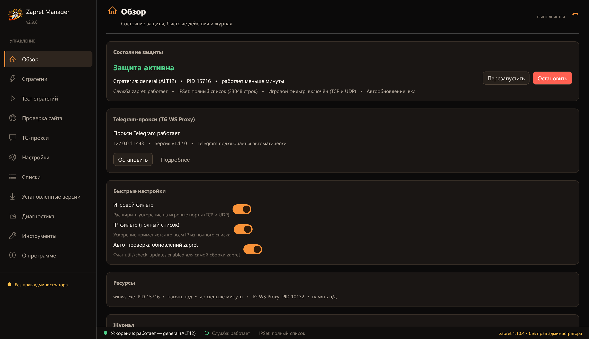
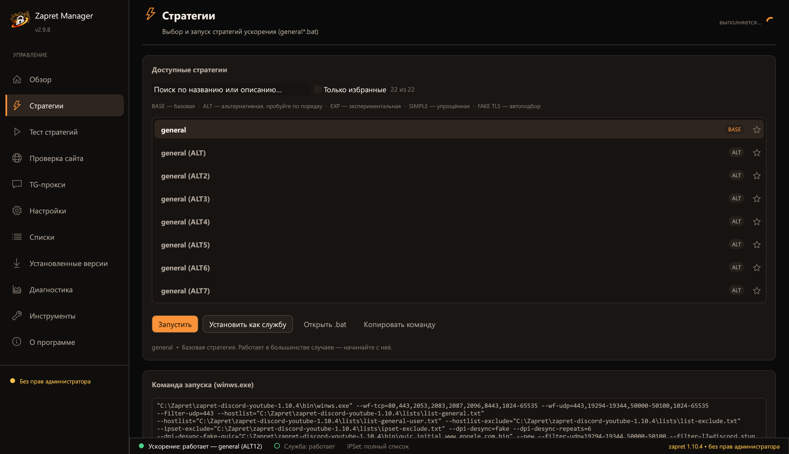
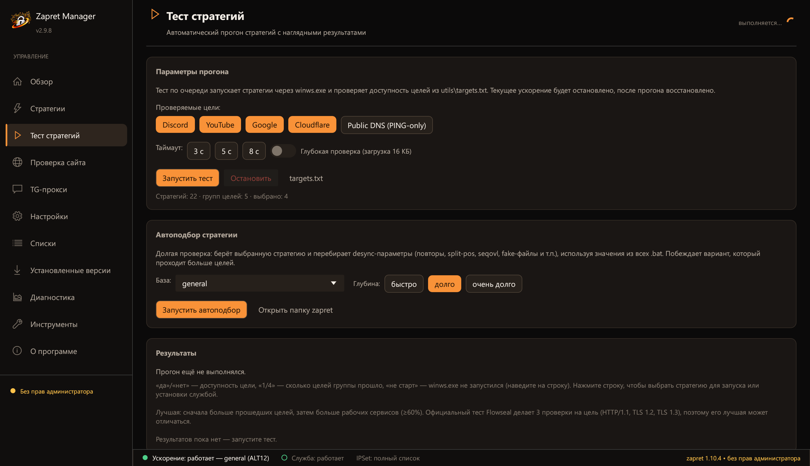
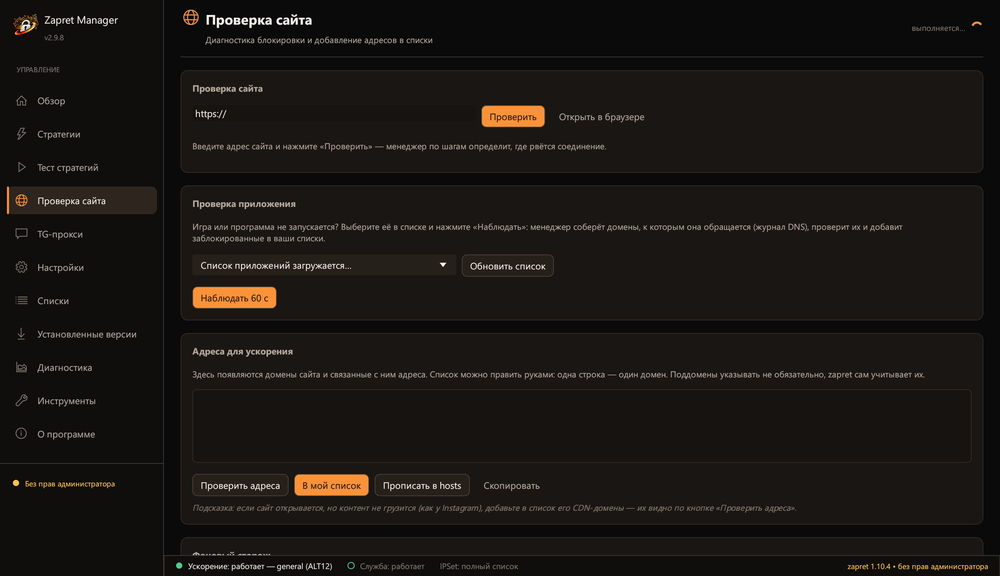
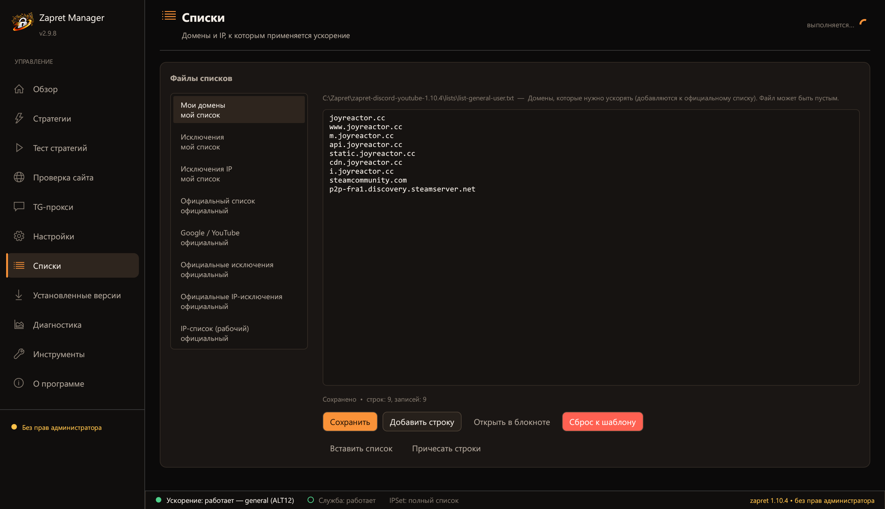
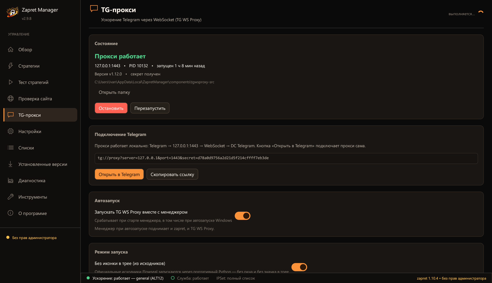
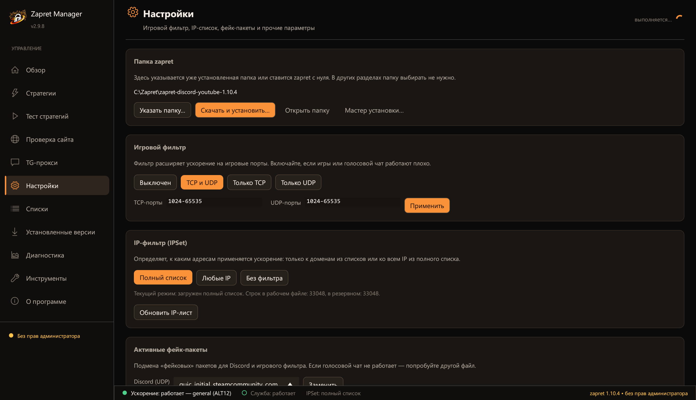
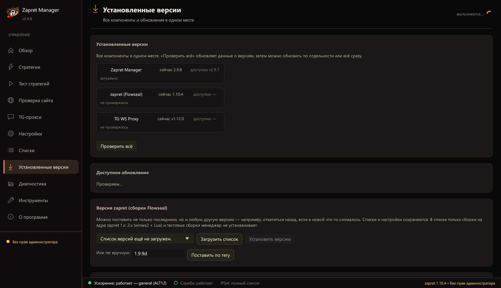
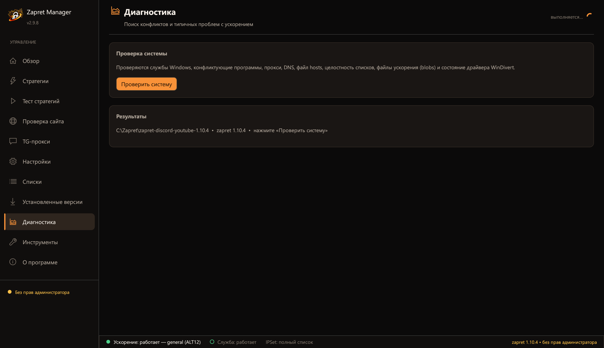
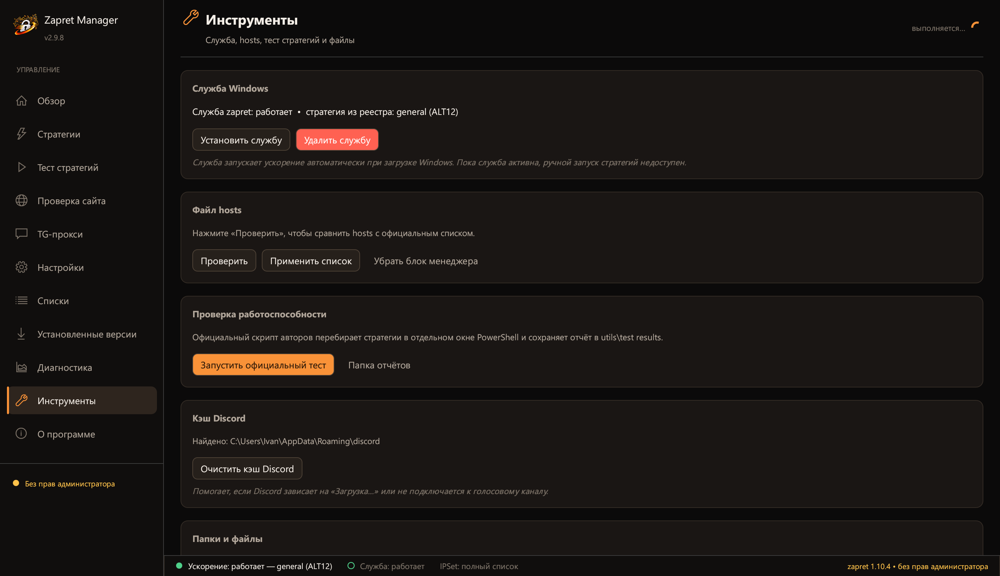

# Zapret Manager — руководство

Актуально для версии **2.9.8**. Скриншоты — [`docs/rust/screenshots`](rust/screenshots),
технические подробности — [`docs/rust/README.md`](rust/README.md), история — [CHANGELOG](../CHANGELOG.md).

Полное руководство по приложению: что делает каждая страница, как выбрать стратегию,
как найти и добавить заблокированные домены, как настроить TG WS Proxy и автозапуск.

- [Что это](#что-это)
- [Что нужно](#что-нужно)
- [Первый запуск](#первый-запуск)
- [Обзор](#обзор)
- [Стратегии](#стратегии)
- [Тест стратегий](#тест-стратегий)
- [Проверка сайта](#проверка-сайта)
- [Проверка приложения](#проверка-приложения)
- [Фоновый сторож сайтов](#фоновый-сторож-сайтов)
- [Списки](#списки)
- [TG WS Proxy](#tg-ws-proxy)
- [Настройки](#настройки)
- [Установленные версии и обновление](#установленные-версии-и-обновление)
- [Диагностика](#диагностика)
- [Инструменты](#инструменты)
- [Старые копии и уборка](#старые-копии-и-уборка)
- [Трей, автозапуск и фоновый режим](#трей-автозапуск-и-фоновый-режим)
- [Права администратора и UAC](#права-администратора-и-uac)
- [Командная строка](#командная-строка)
- [Частые проблемы](#частые-проблемы)
- [Файлы и папки](#файлы-и-папки)
- [Лицензия и благодарности](#лицензия-и-благодарности)

## Что это

Zapret Manager — графическая оболочка для [zapret-discord-youtube](https://github.com/Flowseal/zapret-discord-youtube)
(ускорение соединения, проект `zapret` bol-van) и [TG WS Proxy](https://github.com/Flowseal/tg-ws-proxy)
(прокси для Telegram). Менеджер не содержит самого ускорения: он управляет установкой zapret,
запускает стратегии, ведёт списки доменов, проверяет доступность сайтов и приложений,
следит за обновлениями и держит прокси Telegram.

Поддерживается ядро **zapret 1.x** (`bin\winws.exe`, стратегии `general*.bat`). Установку
**zapret 2.x** (`bin\winws2.exe`, `lua\`) менеджер распознаёт и честно предупреждает, что
не умеет ей управлять и не будет предлагать на неё обновление. Подробнее — в
[README](../README.md#какое-ядро-zapret-поддерживается).



## Что нужно

- Windows 10 или 11 (x64).
- Права администратора для установки службы и записи в `hosts` — менеджер их запросит сам.
- Интернет для первого запуска (скачивание zapret и TG WS Proxy).
- Python **не нужен**: для тихого режима прокси менеджер скачивает портативный Python сам.

Приложение — один файл `ZapretManager.exe`, его можно положить прямо в папку zapret или рядом с ней.

## Первый запуск

1. Запустите `ZapretManager.exe`.
2. Менеджер ищет папку zapret рядом с собой и в соседних папках. Если не нашёл — откроется
   **мастер установки**: выберите расположение, менеджер скачает подходящий релиз с GitHub
   и распакует.
3. Мастер также предложит скачать TG WS Proxy и включить автозапуск.
4. После установки нажмите «Запустить» на странице «Стратегии» — ускорение включится.

Если папка zapret лежит в другом месте: «Настройки» → «Папка zapret» → «Указать папку…»
(или `ZapretManager.exe --root=<папка>`).

## Обзор

Главная страница показывает состояние защиты, версии компонентов, состояние прокси
Telegram, быстрые переключатели, ресурсы и журнал.

- **Состояние защиты** — работает ли ускорение, какая стратегия, PID `winws.exe`, сколько
  времени работает, статус службы, IPSet, игровой фильтр.
- **Обновления** — установленная версия zapret и кнопка «Проверить».
- **Telegram-прокси** — состояние TG WS Proxy, адрес и порт.
- **Быстрые настройки** — игровой фильтр, полный IP-список, авто-проверка обновлений.
- **Ресурсы** — PID, uptime и память `winws.exe` и TG WS Proxy.
- **Журнал** — последние действия и ошибки; копируется выделением.

## Стратегии

Список всех `general*.bat` из вашей установки zapret с метками BASE/ALT/EXP/SIMPLE/FAKE TLS,
описаниями и предупреждением, если авторы пометили стратегию как «NOT RECOMMENDED».

- **Запустить** — запускает выбранную стратегию напрямую через `winws.exe`.
- **Установить службой** — служба `zapret`, чтобы ускорение работало без окна и стартовало
  с Windows.
- **Поиск и ★ избранное** — список запоминает избранные стратегии в `manager.ini`.
- **Команда запуска** — полная строка для `winws.exe`; её можно скопировать.
- Выбранная стратегия запоминается и используется при автозапуске.
- Если стратегия не работает — запустите тест и выберите лучшую.



## Тест стратегий

Менеджер по очереди запускает стратегии и проверяет доступность целей из `utils\targets.txt`
(Discord, YouTube, Google, Cloudflare и публичные DNS).

- Перед прогоном снимается **базовая доступность без ускорения**: цели, которые и так
  открываются, не засчитываются стратегии.
- Результат — таблица: цели «да/нет», «1 из N», вердикт по каждому сервису.
- **Сортировка**: сначала по числу рабочих сервисов (сервис рабочий, если прошло ≥60 %
  его целей), затем по числу пройденных целей; ★ — у лучшей.
- **Автоподбор** — долгий перебор desync-параметров (глубина 40/120/250 вариантов,
  включая `hostfakesplit`, `fake-tls-mod`, `badseq`). Результат сохраняется в
  `general (AUTO).bat`; «Применить и проверить» запускает его и откатывается, если стало хуже.
- **Официальный тест** запускает `utils\test zapret.ps1` и разбирает его отчёт.
- Отчёт сохраняется в `data\test-results.tsv`.



## Проверка сайта

Инструмент «доктор»: введите адрес сайта и нажмите «Проверить». Менеджер проходит шаги:

1. **DNS** — разрешается ли имя;
2. **TCP :443** — устанавливается ли соединение;
3. **TLS** — проходит ли рукопожатие;
4. **HTTP** — отвечает ли сайт.

Вердикт: `ok` — сайт работает; `dpi` — соединение не проходит из-за фильтрации в сети;
`dns` — имя не разрешается; `tls`/`http` — проблемы на стороне сервера; `down` — сайт недоступен.

Найденные домены и адреса попадают в «Адреса для ускорения», откуда их можно добавить
в свой список или в `hosts`.



## Проверка приложения

Для игр и программ, которые не работают без ускорения (например, Battlefield 6).

1. Выберите запущенный процесс в списке (кнопка «Обновить список», если игра только
   что стартовала).
2. Нажмите **«Наблюдать 60 с»**. Менеджер соберёт домены, к которым обращается приложение
   (журнал `Microsoft-Windows-DNS-Client/Operational`) и его внешние адреса (`netstat`).
   Учитываются подпроцессы и все процессы того же приложения — у браузеров и игр сеть
   живёт в отдельном процессе.
3. Каждый домен проверяется по TCP → TLS. Домены, до которых не удалось достучаться, попадают
   в поле «Адреса для ускорения» — остаётся нажать «В мой список».

Служебные домены Windows, Google, Cloudflare, антивирусов и обновлений отфильтровываются.

## Фоновый сторож сайтов

Менеджер читает журнал DNS и сам замечает домены, к которым приложение не смогло подключиться
из-за блокировки, после чего может добавить их в список. Включается на странице «Проверка сайта»
переключателем «Фоновый сторож».

- «Добавлять найденное автоматически» — без подтверждения.
- Работает, пока менеджер запущен (в том числе в трее), один проход — раз в 10 секунд.
- Требует включённого журнала `Microsoft-Windows-DNS-Client/Operational` — менеджер
  включает его сам.
- Служебные и зарезервированные домены (`.local`, `.invalid`, `.test`, обновления Windows,
  антивирусы) отбрасываются, одинаковые имена в журнале схлопываются.
- Добавление в список вступает в силу после перезапуска ускорения — менеджер предложит его
  сделать.

## Списки

Файлы списков из папки `lists`. Для каждого файла — редактор и кнопки сохранения.

Формат строки:

- `example.com` — домен и все его поддомены;
- `^example.com` — строго этот домен (без поддоменов);
- `#`, `;`, `//` — комментарий;
- `*.example.com` — не поддерживается, менеджер предложит заменить на `example.com`.

Возможности:

- **Мои изменения** — при обновлении zapret ваши строки сохраняются и помечаются;
  видно, что добавлено вами, что удалено, что пришло от разработчика.
- **Вставить список** — вставьте сразу много доменов (по одному в строке), менеджер почистит
  пробелы и мусор.
- **Причесать строки** — убрать дубликаты, исправить `*.`, сохранить якоря `^` и CIDR/IPv6.
- **Вернуть удалённые** / **Принять как официальное** — работа с изменениями.

В редакторе 8 файлов: пользовательские `*-user.txt`, официальные `list-general`,
`list-google`, `list-exclude`, `ipset-exclude` и рабочий `ipset-all.txt`.



## TG WS Proxy

Прокси для Telegram через WebSocket, чтобы Telegram работал без обычного VPN.

- **Запустить/Остановить** — управление прокси; состояние и порт видны в карточке.
- **Тихий режим** — прокси запускается без своей иконки в трее, через портативный Python
  (менеджер скачивает его и зависимости сам). Рекомендуется.
- **Режим с треем** — запускается exe из TG WS Proxy со своей иконкой.
- Порт и секрет показываются в карточке; кнопка «Открыть в Telegram» передаёт ссылку
  `tg://proxy` клиенту. Вручную: тип MTProto, сервер `127.0.0.1`, порт из карточки, секрет.
- Автообновление TG WS Proxy — вместе с остальными компонентами.



## Настройки

- **Папка zapret** — выбор уже установленной папки или установка с нуля.
- **Игровой фильтр** — расширяет ускорение на порты 1024–65535 (игры, голосовой чат);
  диапазоны можно менять.
- **IPSet** — «полный список» (`ipset-all`), «любые IP» или «без фильтра».
- **Фейк-пакеты** — выбор файлов для Discord и игрового фильтра; есть аудит и докачивание.
- **Оформление** — «Как в Windows», «Тёмное», «Светлое».
- **Масштаб интерфейса** — 90 %, 100 %, 110 %; применяется сразу.
- **Проверять обновления при запуске** — один раз при старте (и по кнопке «Проверить»).
- **TCP timestamps** — включает соответствующий параметр Windows (иногда помогает).
- **Очистить кэш Discord** — если Discord зависает после включения ускорения.
- **Запуск и автозапуск** — задача Планировщика при входе, сворачивание в трей,
  поднятие zapret и прокси при автозапуске, **автолечение** (перезапуск упавшего winws,
  до 3 попыток).



## Установленные версии и обновление

Страница «Установленные версии» собирает все компоненты в одном месте.

- **Zapret Manager**, **zapret (Flowseal)**, **TG WS Proxy** — текущая и доступная версия.
- **«Проверить всё»** — обновляет данные о версиях, **«Обновить всё»** — ставит доступные.
- **Версия zapret** — можно поставить любую версию из релизов Flowseal, в том числе
  откатиться назад: списки и настройки сохраняются. В списке только сборки на ядре
  **1.x**: релизы 2.x и тестовые сборки (prerelease) менеджер не устанавливает и не предлагает —
  и объясняет это, если такие релизы есть.
- **Резервная копия** — перед обновлением папка zapret сохраняется рядом; после успеха
  остаются две последние копии.
- **Сам менеджер** — при новой версии появляется уведомление; обновление скачивается из
  репозитория менеджера, проверяется по `checksums.txt` и подписи, применяется при выходе.



## Диагностика

Около 30 проверок окружения: права администратора, файлы и версия zapret, ядро (1.x/2.x),
драйвер WinDivert, BFE, процесс `winws.exe`, служба и папка службы, «зависший» WinDivert,
IPSet, системный прокси, TCP timestamps, конфликтующие программы (Killer, Intel
Connectivity, Check Point, SmartByte, VPN, сторонние ускорители), DoH, `hosts`,
целостность списков, аудит fake-файлов, кэш Discord, TG WS Proxy. Часть замечаний
исправляется кнопкой прямо в списке; отчёт можно скопировать — он помогает в Issues.



## Инструменты

- **Служба Windows** — установить/удалить/перезапустить, посмотреть статус.
- **`hosts`** — добавить официальный список или свои адреса с маркерами (легко удалить),
  с резервной копией.
- **Официальный тест** — тест стратегий от авторов zapret.
- **Кэш Discord** — очистка.
- **Резервная копия `.zmb`** — настройки, пользовательские списки, IP-лист и правки
  официальных списков в одном файле; восстановление из копии.
- **Папки** — открыть папку zapret, `bin`, `lists`, `utils`, папку прокси, журнал, данные.
- **Удаление** — удалить zapret, TG WS Proxy, данные менеджера или всё сразу
  (с подтверждением; списки можно сохранить).
- **О программе** — версия, компоненты, ссылки и поддержка.



## Старые копии и уборка

При обновлении zapret менеджер делает полную резервную копию папки — рядом появляется
`zapret-discord-youtube-<версия>_backup_<тег>_<дата>`. Копии нужны, чтобы откатиться,
но занимают место (обычно 5–30 МБ каждая).

- после успешного обновления менеджер **сам оставляет только две последние копии**,
  остальные удаляет и пишет в журнал, сколько освободил;
- вручную: «Инструменты» → «Папки» → **«Старые копии»** — покажет количество и размер,
  оставит самую свежую и удалит остальные (или `ZapretManager.exe --cleanup`);
- временные файлы (`%TEMP%\ZapretManager`) чистятся при запуске и по `--cleanup`;
- остатки самообновления (`ZapretManager*.old.exe`) удаляются автоматически при запуске.

Разные версии zapret, установленные через «Установить версию», лежат отдельными папками
рядом — их менеджер не удаляет, это ваши установки.

## Трей, автозапуск и фоновый режим

- Кнопка закрытия сворачивает окно в трей (настраивается).
- **Одиночный клик по значку открывает окно** (как в проводнике), правый клик — меню.
- Из меню: открыть менеджер, включить/выключить zapret и прокси, выйти.
- Автозапуск создаёт задачу Планировщика с наивысшими правами — при входе в Windows
  менеджер стартует без запроса UAC, поднимает ускорение и прокси и уходит в трей.

## Права администратора и UAC

Менеджер работает и без администратора (ограниченный режим: `--limited`), но установка
службы, запись в `hosts` и часть настроек требуют прав.

- **Один раз при запуске** Windows спросит подтверждение — это обычный запрос UAC.
- **Автозапуск** создаёт задачу Планировщика (`ONLOGON`, `HIGHEST`): при входе в систему
  она запускает **только `ZapretManager.exe`** с полными правами, без запроса. Другие
  программы это не затрагивает.
- **Менеджер не отключает UAC в системе и не содержит скриптов для этого.** Если запросы UAC
  выключены кем-то ещё (`ConsentPromptBehaviorAdmin=0`), это действует на **все** программы
  на компьютере — и это уже не про менеджер. Вернуть как было: `ConsentPromptBehaviorAdmin=5`,
  `PromptOnSecureDesktop=1`, Параметры → «Контроль учётных записей» либо
  `ZapretManager.exe --restore-uac`.

Вернуть стандартное поведение автозапуска можно, выключив тумблер «Запускать Zapret Manager
при входе в Windows» — задача Планировщика будет удалена.

## Командная строка

| Ключ | Что делает |
| --- | --- |
| `--root <папка>` | запустить с указанной папкой zapret |
| `--tray` | запустить сразу в трее |
| `--autostart` | служебный режим автозапуска (поднимает ускорение и прокси) |
| `--limited` | запустить без прав администратора |
| `--elevated` | служебный: признак уже запрошенного UAC |
| `--diag` | прогнать диагностику в журнал и выйти |
| `--selftest` | 11 внутренних проверок, код возврата 0/1 |
| `--check-site=<домен>` | проверить сайт из командной строки |
| `--app-watch=<PID>` | наблюдение за приложением и добавление найденного |
| `--guard-once` | один проход фонового сторожа |
| `--blobs-repair` | проверить и докачать fake-файлы |
| `--cleanup` | убрать старые копии, временные файлы и `*.old.exe` |
| `--restore-uac` | вернуть стандартные значения UAC (5/1) |
| `--tg-prepare`, `--tg-start`, `--tg-stop` | управление TG WS Proxy из скриптов |
| `--check-self` | проверить обновление менеджера и выйти |
| `--self-update` | обновиться без интерфейса |
| `--apply-update` | служебный режим замены exe |
| `--shot=<файл>`, `--shot-page=<страница>` | снимок окна (для документации) |

## Частые проблемы

**Ускорение включено, но Discord/YouTube не работают.** Запустите «Тест стратегий» и выберите
стратегию с зелёными результатами. Проверьте, что служба `zapret` работает.

**Игра не запускается.** «Проверка сайта» → «Проверка приложения» → выберите игру →
«Наблюдать 60 с» → «В мой список». Дополнительно включите игровой фильтр в настройках.

**Сайт открывается, но видео не грузится.** Добавьте домены сайта через «Проверку сайта»
(он покажет, где рвётся) и перезапустите ускорение.

**Telegram не подключается.** Проверьте, что TG WS Proxy запущен и порт с секретом
совпадают с настройками Telegram. В тихом режиме первый запуск дольше: скачивается Python.

**Менеджер просит права при каждом запуске.** Включите автозапуск: он создаёт задачу
Планировщика с наивысшими правами, и запросы UAC прекращаются.

**После обновления пропали мои домены.** Они в файлах `*-user.txt`; проверьте карточку
«Мои изменения» на странице «Списки» и нажмите «Вернуть удалённые», если нужно.

**Менеджер пишет «Zapret 2.x — другое ядро».** В папке лежит сборка на новом ядре
(`bin\winws2.exe`, `lua\`, правила `--lua-desync`). Менеджер ей не управляет и обновления
на 2.x не предлагает: запускайте её через собственный `service.bat`. Чтобы вернуться на
поддерживаемую ветку, поставьте любую версию 1.x на странице «Установленные версии».

**«Доступна версия 2.0.0-rc», но обновиться не даёт.** Так и должно быть: тестовые сборки
и zapret 2.x не устанавливаются. Если рядом есть более новая 1.x — она будет предложена.

**Антивирус ругается.** WinDivert и `winws.exe` — легитимные компоненты zapret, которые
используют драйвер для фильтрации пакетов. Добавьте папку zapret в исключения.

## Файлы и папки

```
zapret-discord-youtube-<версия>\
  bin\winws.exe            движок ускорения
  lists\                   списки доменов и IP
  utils\                   цели теста и служебные флаги
  service.bat              стратегии и установка службы
  ZapretManager.exe        менеджер

data\manager.ini           настройки менеджера
data\manager.log           журнал (ротация 512 КБ)
data\test-results.tsv      отчёт теста стратегий
data\lists\                ваши правки официальных списков (.changes/.baseline)
components\tgwsproxy\      TG WS Proxy (exe)
components\tgwsproxy-src\  тихий режим: исходники, портативный Python, prepared.txt
%TEMP%\ZapretManager\      временные файлы и бэкапы обновлений
```

Файлы `lists\*-user.txt` — ваши правки, они не перезаписываются при обновлении zapret.

## Лицензия и благодарности

Проект распространяется по MIT License (см. [LICENSE](../LICENSE)).

Ускорение соединения — [zapret](https://github.com/bol-van/zapret) (bol-van),
сборка и стратегии — [zapret-discord-youtube](https://github.com/Flowseal/zapret-discord-youtube)
(Flowseal и контрибьюторы), прокси Telegram — [TG WS Proxy](https://github.com/Flowseal/tg-ws-proxy)
(Flowseal), драйвер WinDivert — [basil00/WinDivert](https://github.com/basil00/WinDivert).
Спасибо им за работу, без которой этого приложения не было бы.

Поддержать проект: [Boosty](https://boosty.to/robin19666) ·
[DonationAlerts](https://www.donationalerts.com/r/robin19666) — «на хлебушек».

Проект сделан с помощью инструмента **[DeepSeek Harness](https://deepseek.com)** — агентной
среды разработки: код, документация и проверки писались и ревьюились в ней.
