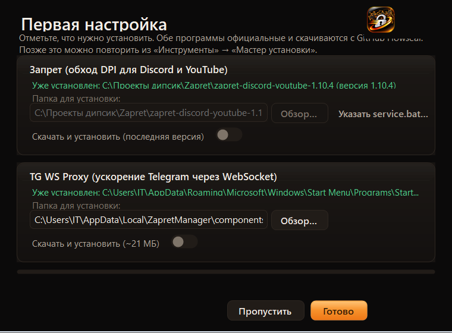
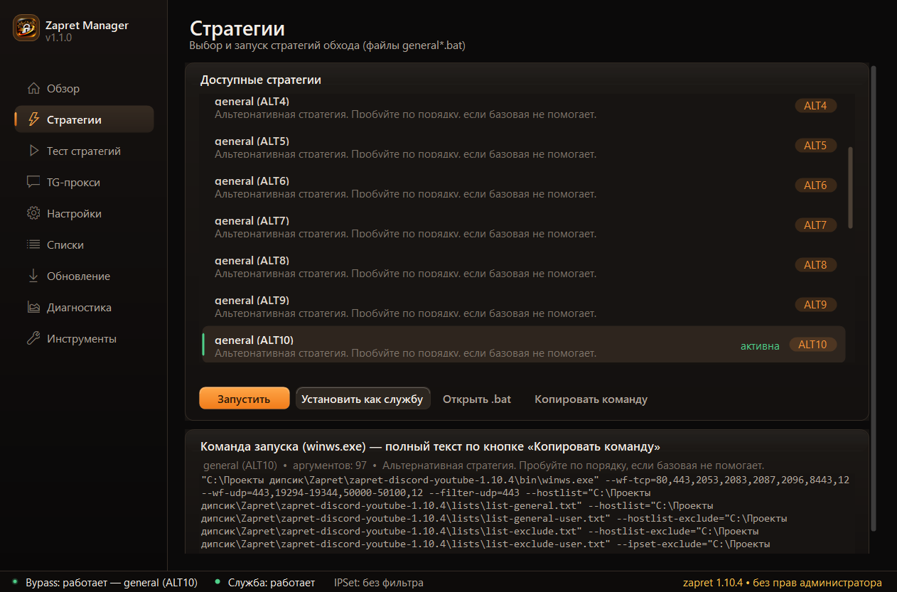
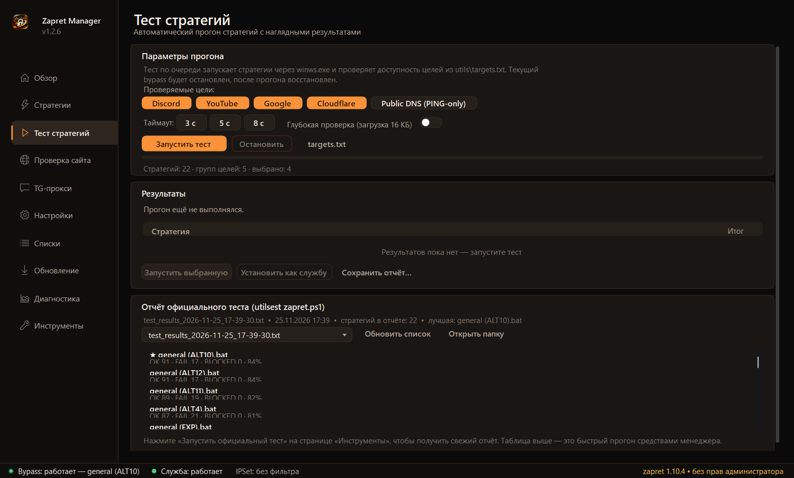
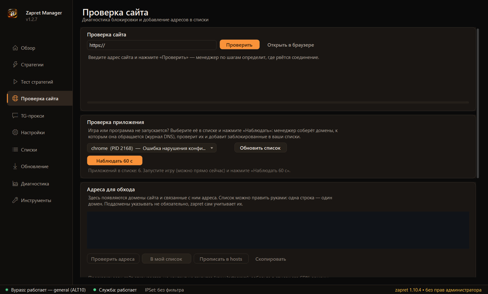
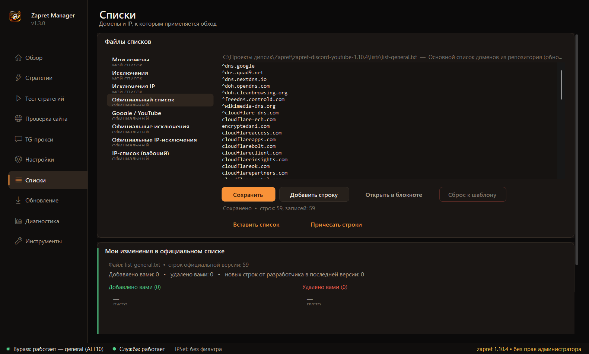
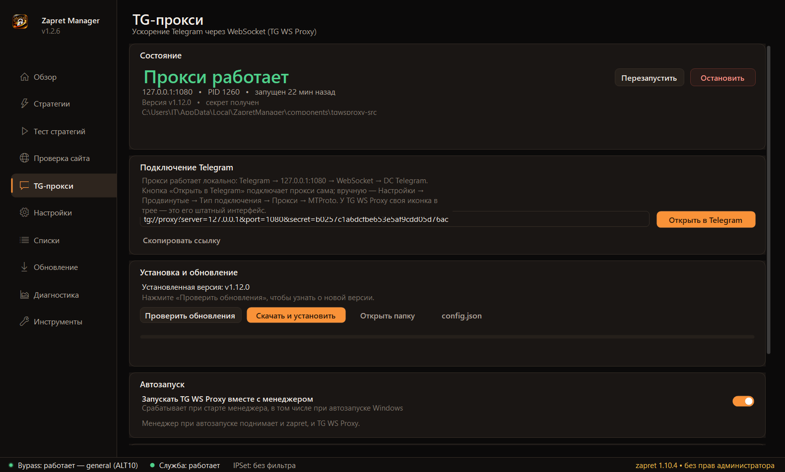
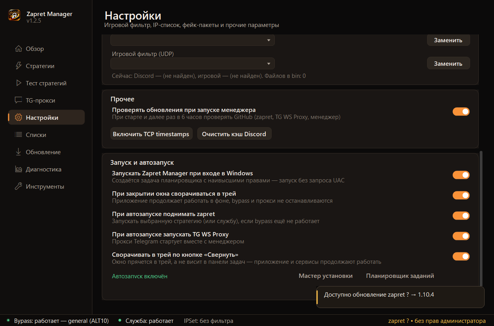
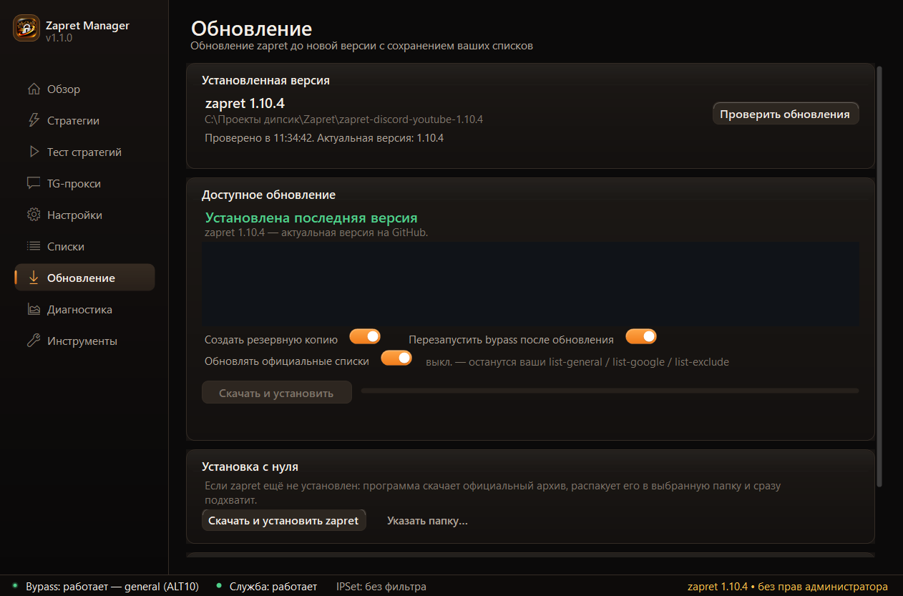
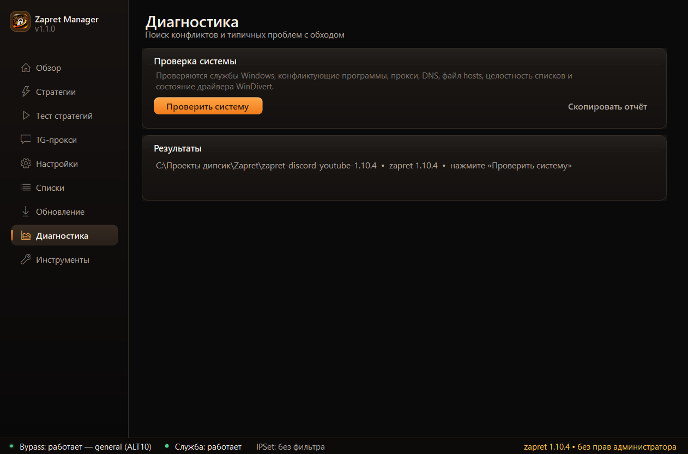
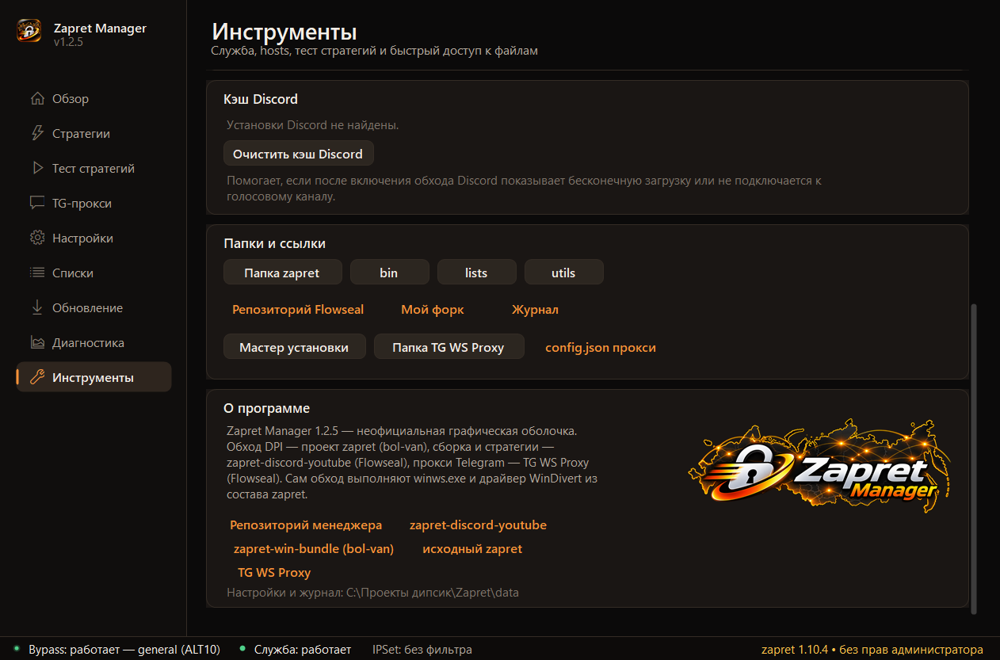

> **Ветка `rust-rewrite`:** руководство описывает возможности приложения; скриншоты и часть
> формулировок относятся к C#-версии из ветки `main`. Актуальные скриншоты Rust-версии —
> в [`docs/rust/screenshots`](rust/screenshots), отличия — в [`docs/rust/README.md`](rust/README.md).
# Zapret Manager — руководство

Полное руководство по приложению: что делает каждая страница, как выбрать стратегию,
как найти и добавить заблокированные домены, как настроить TG WS Proxy и автозапуск.

- [Что это](#что-это)
- [Что нужно](#что-нужно)
- [Первый запуск](#первый-запуск)
- [Обзор](#обзор)
- [Стратегии](#стратегии)
- [Тест стратегий](#тест-стратегий)
- [Проверка сайта](#проверка-сайта)
- [Проверка приложения](#проверка-приложения)
- [Фоновый сторож сайтов](#фоновый-сторож-сайтов)
- [Списки](#списки)
- [TG WS Proxy](#tg-ws-proxy)
- [Настройки](#настройки)
- [Обновление](#обновление)
- [Диагностика](#диагностика)
- [Инструменты](#инструменты)
- [Трей, автозапуск и фоновый режим](#трей-автозапуск-и-фоновый-режим)
- [Права администратора и UAC](#права-администратора-и-uac)
- [Командная строка](#командная-строка)
- [Частые проблемы](#частые-проблемы)
- [Файлы и папки](#файлы-и-папки)
- [Лицензия и благодарности](#лицензия-и-благодарности)

## Что это

Zapret Manager — графическая оболочка для [zapret-discord-youtube](https://github.com/Flowseal/zapret-discord-youtube)
(ускорение соединения, проект `zapret` bol-van) и [TG WS Proxy](https://github.com/Flowseal/tg-ws-proxy)
(прокси для Telegram). Менеджер не содержит самого ускорения: он управляет установкой zapret,
запускает стратегии, ведёт списки доменов, проверяет доступность сайтов и приложений,
следит за обновлениями и держит прокси Telegram.


## Что нужно

- Windows 10 или 11 (x64).
- Права администратора для установки службы и записи в `hosts` — менеджер их запросит сам.
- Интернет для первого запуска (скачивание zapret и TG WS Proxy).
- Python **не нужен**: для тихого режима прокси менеджер скачивает портативный Python сам.

Приложение — один файл `ZapretManager.exe`, его можно положить прямо в папку zapret или рядом с ней.

## Первый запуск

1. Запустите `ZapretManager.exe`.
2. Менеджер ищет папку zapret рядом с собой и в соседних папках. Если не нашёл — откроется
   **мастер установки**: выберите расположение и версию zapret, менеджер скачает архив с GitHub
   и распакует.
3. Мастер также предложит скачать TG WS Proxy и включить автозапуск.
4. После установки нажмите «Запустить» на странице «Стратегии» — ускорение включится.



Если папка zapret лежит в другом месте: «Инструменты» → «Папка zapret» или «Мастер установки».

## Обзор

Главная страница показывает состояние защиты, версию zapret, состояние прокси Telegram,
быстрые переключатели и журнал.

- **Состояние защиты** — работает ли ускорение, какая стратегия, PID `winws.exe`, сколько времени
  работает, статус службы, IPSet, игровой фильтр.
- **Обновления** — установленная версия zapret и кнопка «Проверить».
- **Telegram-прокси** — состояние TG WS Proxy, адрес и порт.
- **Быстрые настройки** — игровой фильтр, полный IP-список, авто-проверка обновлений.
- **Журнал** — последние действия и ошибки; копируется выделением.

## Стратегии

Список стратегий из `service.bat` вашей сборки zapret с описанием.

- **Запустить** — запускает ускорение: служба Windows (если есть права) или прямой запуск `winws.exe`.
- **Остановить** — останавливает службу и процесс.
- **Служба** — установить/удалить службу `zapret`, чтобы ускорение работало без окна и запускалось с Windows.
- Выбранная стратегия запоминается и используется при автозапуске.
- Если стратегия не работает — запустите тест и выберите лучшую.



## Тест стратегий

Менеджер по очереди запускает стратегии и проверяет доступность Discord, YouTube, Google.

- Результат — таблица: стратегия, доступность каждого сервиса, средняя задержка, вердикт.
- «Официальный тест» запускает скрипт авторов zapret и разбирает его отчёт.
- Лучшую стратегию можно применить сразу из таблицы.



## Проверка сайта

Инструмент «доктор»: введите адрес сайта и нажмите «Проверить». Менеджер проходит шаги:

1. **DNS** — разрешается ли имя;
2. **TCP :443** — устанавливается ли соединение;
3. **TLS** — проходит ли рукопожатие;
4. **HTTP** — отвечает ли сайт.

Вердикт: `ok` — сайт работает; `dpi` — похоже на блокировку ТСПУ (обрыв TLS/сброс);
`dns` — не resolution; `tls`/`http` — проблемы на стороне сервера; `down` — сайт недоступен.

Найденные домены и адреса попадают в «Адреса для ускорения», откуда их можно добавить
в свой список или в `hosts`.



## Проверка приложения

Для игр и программ, которые не работают без ускорения (например, Battlefield 6).

1. Выберите запущенный процесс в списке (кнопка «Обновить список», если игра только
   что стартовала).
2. Нажмите **«Наблюдать 60 с»**. Менеджер соберёт домены, к которым обращается приложение
   (журнал `Microsoft-Windows-DNS-Client/Operational`) и его внешние адреса (`netstat`).
   Учитываются подпроцессы и все процессы того же приложения — у браузеров и игр сеть
   живёт в отдельном процессе.
3. Каждый домен проверяется по TCP → TLS. Всё, что похоже на блокировку ТСПУ, попадает
   в поле «Адреса для ускорения» — остаётся нажать «В мой список».

Служебные домены Windows, Google, Cloudflare, антивирусов и обновлений отфильтровываются.

## Фоновый сторож сайтов

Менеджер читает журнал DNS и сам замечает домены, к которым браузер не смог подключиться
из-за блокировки, после чего добавляет их в список. Включается на странице «Проверка сайта»
переключателем «Фоновый сторож».

- «Добавлять найденное автоматически» — без подтверждения.
- Работает, пока менеджер запущен (в том числе в трее).
- Требует включённого журнала `Microsoft-Windows-DNS-Client/Operational` — менеджер
  включает его сам при первом запуске сторожа.


## Списки

Файлы списков из папки `lists`. Для каждого файла — редактор и кнопки сохранения.

Формат строки:

- `example.com` — домен и все его поддомены;
- `^example.com` — строго этот домен (без поддоменов);
- `#`, `;`, `//` — комментарий;
- `*.example.com` — не поддерживается, менеджер предложит заменить на `example.com`.

Возможности:

- **Мои изменения** — при обновлении zapret ваши строки сохраняются и помечаются;
  видно, что добавлено вами, что удалено, что пришло от разработчика.
- **Вставить список** — вставьте сразу много доменов (по одному в строке), менеджер почистит
  пробелы и мусор.
- **Причесать строки** — убрать дубликаты, исправить `*.`, сохранить якоря `^` и CIDR/IPv6.
- **Вернуть удалённые** / **Принять как официальное** — работа с изменениями.



## TG WS Proxy

Прокси для Telegram через WebSocket, чтобы Telegram работал без обычного VPN.

- **Запустить/Остановить** — управление прокси.
- **Тихий режим** — прокси запускается без своей иконки в трее, через портативный Python
  (менеджер скачивает его и зависимости сам). Рекомендуется.
- **Режим с треем** — запускается exe из TG WS Proxy со своей иконкой.
- Порт и секрет показываются в карточке; их нужно вставить в настройки Telegram
  (или в клиент с поддержкой MTProxy).
- Автообновление TG WS Proxy — вместе с остальными компонентами.



## Настройки

- **Игровой фильтр** — расширяет ускорение на порты 1024–65535 (игры, голосовой чат).
- **Полный IP-список** — фильтрация по `ipset-all` (по умолчанию выключено: работаем по доменам).
- **Фейк-пакеты** — выбор файлов для Discord и игрового фильтра.
- **Оформление** — «Как в Windows», «Тёмное», «Светлое».
- **Масштаб интерфейса** — 90 %, 100 %, 110 %; применяется сразу.
- **Проверять обновления при запуске** — при старте и далее раз в 6 часов.
- **TCP timestamps** — включает соответствующий параметр Windows (иногда помогает).
- **Очистить кэш Discord** — если Discord зависает после включения ускорения.
- **Запуск и автозапуск** — задача Планировщика при входе, сворачивание в трей,
  поднятие zapret и прокси при автозапуске.



## Обновление

- **zapret** — «Обновление» → «Проверить». Можно выбрать и установить любую версию из релизов
  Flowseal; свои правки списков сохраняются.
- **TG WS Proxy** — обновляется оттуда же.
- **Сам менеджер** — при новой версии появляется уведомление; обновление скачивается из
  репозитория менеджера и применяется при выходе (портативная замена exe).



## Диагностика

Проверки окружения: найден ли `winws.exe`, драйвер WinDivert, служба, права, доступность
GitHub, состояние `hosts`, TCP timestamps, порт прокси. Отчёт можно скопировать —
он помогает при обращении в Issues.



## Инструменты

- **`hosts`** — добавить адреса в `hosts` с маркерами (легко удалить), с бэкапом.
- **Проверка работоспособности** — официальный тест авторов zapret.
- **Кэш Discord** — очистка.
- **Папки** — открыть папку zapret, `bin`, `lists`, `utils`, папку прокси, мастер установки,
  журнал менеджера.
- **О программе** — версия, ссылки на проекты и поддержка.



## Старые копии и уборка

При обновлении zapret менеджер делает полную резервную копию папки — рядом появляется
`zapret-discord-youtube-<версия>_backup_<тег>_<дата>`. Копии нужны, чтобы откатиться,
но занимают место (обычно 5–30 МБ каждая).

- после успешного обновления менеджер **сам оставляет только две последние копии**,
  остальные удаляет и пишет в журнал, сколько освободил;
- вручную: «Инструменты» → «Папки» → **«Старые копии»** — покажет количество и размер,
  оставит самую свежую и удалит остальные;
- временные файлы обновлений (`%TEMP%\ZapretManagerUpdate`) чистятся при запуске
  (старше 7 дней), а скачанный файл новой версии удаляется сразу после замены.

Разные версии zapret, установленные вручную через «Выбор версии», лежат отдельными папками
рядом — их менеджер не удаляет, это ваши установки. Ненужные можно удалить вручную.

## Трей, автозапуск и фоновый режим

- Кнопка закрытия сворачивает окно в трей (настраивается).
- Из трея: открыть менеджер, включить/выключить zapret и прокси, выйти.
- Автозапуск создаёт задачу Планировщика с наивысшими правами — при входе в Windows
  менеджер стартует без запроса UAC, поднимает ускорение и прокси и уходит в трей.

## Права администратора и UAC

Менеджер работает и без администратора (ограниченный режим), но установка службы, запись
в `hosts` и часть настроек требуют прав.

- **Один раз при запуске** Windows спросит подтверждение — это обычный запрос UAC.
- **Автозапуск** создаёт задачу Планировщика (`ONLOGON`, `HIGHEST`): при входе в систему
  она запускает **только `ZapretManager.exe`** с полными правами, без запроса. Другие
  программы это не затрагивает.
- **Менеджер не отключает UAC в системе и не содержит скриптов для этого.** Если запросы UAC выключены кем-то ещё
  (`ConsentPromptBehaviorAdmin=0`), это действует на **все** программы на компьютере —
  и это уже не про менеджер. Вернуть как было: `ConsentPromptBehaviorAdmin=5`,
  `PromptOnSecureDesktop=1`, Параметры → «Контроль учётных записей» либо `ZapretManager.exe --restore-uac`.

Вернуть стандартное поведение автозапуска можно, выключив тумблер «Запускать Zapret Manager
при входе в Windows» — задача Планировщика будет удалена.
## Командная строка

| Ключ | Что делает |
| --- | --- |
| `--root <папка>` | запустить с указанной папкой zapret |
| `--tray` | запустить сразу в трее |
| `--autostart` | служебный режим автозапуска (поднимает ускорение и прокси) |
| `--limited` | запустить без прав администратора |
| `--self-update` | применить отложенное обновление менеджера |
| `--tg-start`, `--tg-stop`, `--tg-prepare` | управление TG WS Proxy из скриптов |
| `--guard-once` | один проход фонового сторожа |
| `--restore-uac` | вернуть стандартные значения UAC (5/1) |
| `--check-self` | проверить обновления менеджера и выйти (диагностика) |
| `--cleanup` | оставить одну резервную копию и почистить временные файлы |
| `--app-watch=<PID>` | 20 секунд наблюдения за приложением, проверка и добавление найденного |
| `--shot=<файл>`, `--shot-page=<страница>` | снимок окна (для документации) |

## Частые проблемы

**Ускорение включено, но Discord/YouTube не работают.** Запустите «Тест стратегий» и выберите
стратегию с зелёными результатами. Проверьте, что служба `zapret` работает.

**Игра не запускается.** «Проверка сайта» → «Проверка приложения» → выберите игру →
«Наблюдать 60 с» → «В мой список». Дополнительно включите игровой фильтр в настройках.

**Сайт открывается, но видео не грузится.** Добавьте домены сайта через «Проверку сайта»
(он покажет, где рвётся) и перезапустите ускорение.

**Telegram не подключается.** Проверьте, что TG WS Proxy запущен и порт с секретом
совпадают с настройками Telegram. В тихом режиме первый запуск дольше: скачивается Python.

**Менеджер просит права при каждом запуске.** Включите автозапуск: он создаёт задачу
Планировщика с наивысшими правами, и запросы UAC прекращаются.

**После обновления пропали мои домены.** Они в файлах `*-user.txt`; проверьте карточку
«Мои изменения» на странице «Списки» и нажмите «Вернуть удалённые», если нужно.

**Антивирус ругается.** WinDivert и `winws.exe` — легитимные компоненты zapret, которые
используют драйвер для фильтрации пакетов. Добавьте папку zapret в исключения.

## Файлы и папки

```
zapret-discord-youtube-<версия>\
  bin\winws.exe            движок ускорения
  lists\                   списки доменов и IP
  utils\                   утилиты и шаблоны
  service.bat              стратегии и установка службы
  ZapretManager.exe        менеджер

data\manager.ini           настройки менеджера
data\manager.log           журнал
components\tgwsproxy\      TG WS Proxy
components\tgwsproxy-src\  тихий режим (портативный Python)
```

Файлы `lists\*-user.txt` — ваши правки, они не перезаписываются при обновлении zapret.

## Лицензия и благодарности

Проект распространяется по MIT License (см. [LICENSE](../LICENSE)).

Ускорение соединения — [zapret](https://github.com/bol-van/zapret) (bol-van),
сборка и стратегии — [zapret-discord-youtube](https://github.com/Flowseal/zapret-discord-youtube)
(Flowseal), прокси Telegram — [TG WS Proxy](https://github.com/Flowseal/tg-ws-proxy) (Flowseal),
драйвер WinDivert — [basil00/WinDivert](https://github.com/basil00/WinDivert).

Поддержать проект: [Boosty](https://boosty.to/robin19666) ·
[DonationAlerts](https://www.donationalerts.com/r/robin19666) — «на хлебушек».
